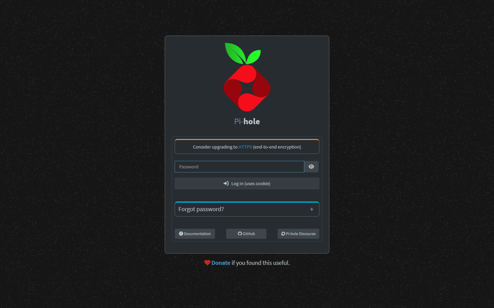
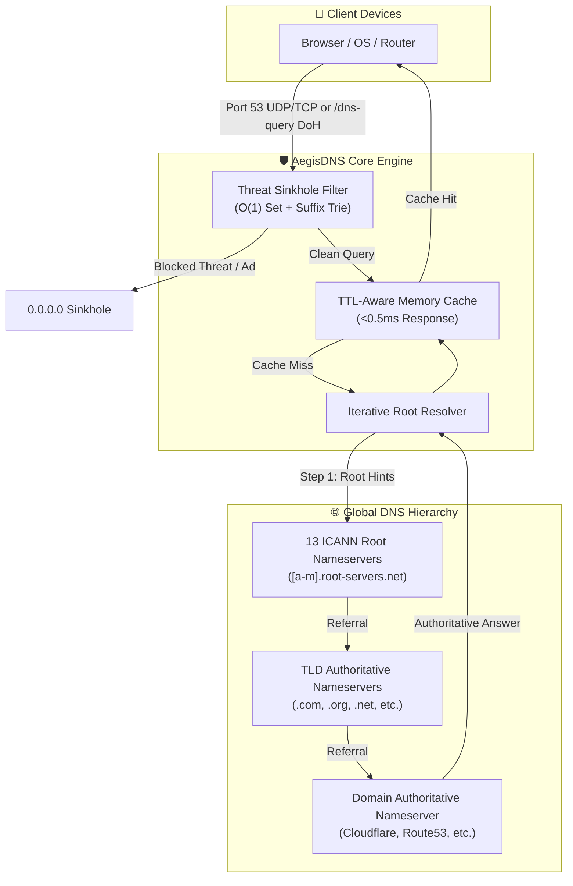

<div align="center">

# 🛡️ AegisDNS

### Next-Gen Recursive Resolver, RFC 8484 DoH Sinkhole & Cyber Defense Command Center
**Direct ICANN Root Nameserver Traversal, Encrypted DNS-over-HTTPS (DoH), Real-Time Threat Intelligence Sinkholing, and SafeSearch Enforcement.**

<p align="center">
  
  
  
  
  
</p>

</div>

---

## 📸 Production Preview

*High-Availability DNS cluster command center: multi-node query telemetry, active sinkhole block rates, and live query stream.*



---

## 🌟 Overview

**AegisDNS** solves the structural limitations of legacy ad-blockers and DNS forwarders:

1. **Pure Iterative Root Recursion**: Directly queries the 13 ICANN root nameserver clusters (`[a-m].root-servers.net`) and traverses down to authoritative TLD nameservers—preventing upstream ISP and commercial DNS tracking.
2. **Encrypted DNS-over-HTTPS (DoH)**: Full compliance with RFC 8484 (`/dns-query` binary wire format) and RFC 8427 JSON DoH for secure, encrypted resolution on mobile, browsers, and remote devices.
3. **Multi-Stage Threat Sinkhole**: High-velocity in-memory O(1) domain set lookups, suffix trie matching, regex evaluation, and automated threat feeds (StevenBlack, URLhaus malware C2, OISD, Phishing Army).
4. **Cyber Command Center**: A real-time glassmorphic dark dashboard with WebSocket telemetry streams, 24-hour traffic analytics, 1-click domain quick-actions, and an interactive domain auditor.

---

## 🏗️ Hierarchical Resolution Flow



---

## ⚡ Key Features

- **🚀 Recursive Root Resolver Engine**: Direct hierarchical resolution starting at root hints with automatic fallback to upstream DoH (Quad9, Cloudflare) or local Unbound daemon (`127.0.0.1:5335`).
- **🔒 RFC 8484 DNS-over-HTTPS (DoH)**: Native `/dns-query` endpoint supporting both binary wire format and JSON format (`application/dns-json`).
- **🛡️ Active Threat & Ad Blocking**: Pre-loaded baseline protection + multi-feed automated ingestion stopping malware, crypto-miners, phishing, telemetry, and adware.
- **⚡ Blazing Fast In-Memory Cache**: Adaptive TTL-aware memory cache responding to repeated lookups in **< 0.5 ms**.
- **🔍 Domain Threat Intelligence Auditor**: Interactive sandbox allowing you to inspect any domain against security heuristics, verify block status, and trace resolution routes in real time.
- **🌐 Homelab Local DNS Overrides**: Custom `A`, `AAAA`, `CNAME`, and `TXT` record management for local services (`*.home.lab`, `*.local`, etc.).
- **🔐 SafeSearch Enforcement**: 1-click network-wide strict SafeSearch redirection for Google, YouTube, Bing, and DuckDuckGo.
- **📊 Real-Time WebSocket Telemetry**: Streaming live query feed with instant 1-click **Quick Whitelist** and **Quick Block** actions.

---

## 📊 Feature Comparison

| Capability | AegisDNS | Pi-hole | AdGuard Home | Technitium |
| :--- | :---: | :---: | :---: | :---: |
| **Built-in Pure Root Recursion** | ✅ Native | ❌ Needs Unbound | ❌ Needs Unbound | ✅ Native |
| **Encrypted DoH Endpoint (RFC 8484)** | ✅ Native | ❌ Plugin Needed | ✅ Native | ✅ Native |
| **Executive Glassmorphism UI** | ✅ Modern Cyber | ❌ Classic Admin | ⚠️ Minimalist | ❌ Classic ASP.NET |
| **Real-Time WebSocket Stream** | ✅ Built-in | ❌ Polling/Tail | ⚠️ Polling | ⚠️ Polling |
| **1-Click Quick Allow/Block** | ✅ Instant | ⚠️ Multi-step | ⚠️ Multi-step | ❌ Manual |
| **Domain Threat Auditor** | ✅ Built-in | ❌ CLI Only | ⚠️ Basic Query | ⚠️ Basic Test |
| **SafeSearch Interception** | ✅ Built-in | ❌ Complex Regex | ✅ Built-in | ⚠️ Plugin |
| **Homelab Local DNS Records** | ✅ Built-in | ✅ Built-in | ✅ Built-in | ✅ Built-in |

---

## 🛠️ Quickstart

### Local Workstation (Windows, Linux, macOS)
```bash
git clone https://github.com/ertechlab/aegisdns.git
cd aegisdns
pip install -r requirements.txt
python -m aegisdns.server --port 53 --http-port 8053
```
Open **http://localhost:8053** in your browser.

### Docker Compose
```yaml
version: "3.8"
services:
  aegisdns:
    image: aegisdns:latest
    container_name: aegisdns
    ports:
      - "53:53/udp"
      - "53:53/tcp"
      - "8053:8053/tcp"
    volumes:
      - ./data:/app/data
    restart: unless-stopped
```

```bash
docker compose up -d
```

---

## 📄 License
MIT License. Created by ERTech Lab.
